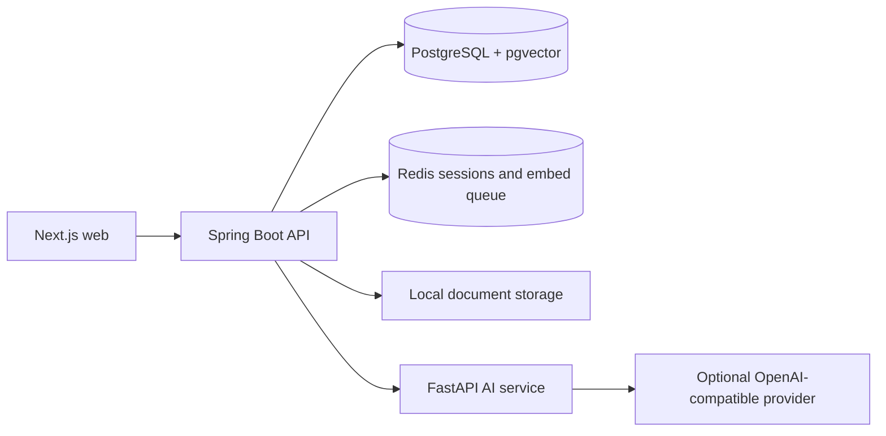

# Kiro project guide

Kiro is an internal company knowledge desk. It helps teams find answers in their documents and inspect the passages behind those answers, while keeping retrieval scoped to the user's workspace and document access.

## Features and status

| Feature | Actual implementation / status |
| --- | --- |
| Accounts | Email/password registration creates a workspace and its first admin; bcrypt passwords, JWT authentication, session records and Redis session checks. No external auth provider or email verification. |
| Library | Upload PDF, DOCX, XLSX, CSV, Markdown or text (10 MB UI limit), or paste text. Search/filter/sort document rows and read full content. Implemented; live persistence not tested in this documentation pass. |
| Answers | SQL keyword search plus optional vector search; rank fusion selects up to five passages. Model answers have citations; failed model calls fall back to explicitly labelled source extracts. No evidence returns an unknown answer. |
| Evidence and history | Citations open excerpts/full documents; conversations, responses, evidence, feedback and audit records are persisted. Confidence is a retrieval heuristic, not a probability of correctness. |
| Access | Tenant, owner and USER/ROLE ACL predicates are applied in SQL before model prompts. Public means within the workspace. GROUP grants grant no access: group membership is not implemented. |
| Demo | Northwind handbook seed data is fictional. The public landing example is static illustrative content, not an API-generated answer. |
| Operations | Admin health/metrics and embedding failure/retry APIs/UI; actual service data requires the backend. |
| Integrations | Drive, Slack and CRM connectors return no documents and synthetic health values. S3 is unwired and falls back to local storage. No live connector sync. |

## Architecture

| Folder / file | Responsibility |
| --- | --- |
| `apps/web` | Next.js 15 / React 19 / TypeScript; `/` marketing, `/app` workspace/auth, `/admin`, `/design-system`; semantic CSS and shared UI primitives |
| `apps/api-java` | Default Java 21 / Spring Boot 3 API; Maven, JPA, Flyway migrations, PDFBox/POI parsing, SQL retrieval and Redis-list embedding worker |
| `apps/ai` | Python / FastAPI / httpx; `/embed`, `/generate`, `/gateway`, `/admin/health`; OpenAI-compatible HTTP clients |
| `apps/api` | Retained NestJS / Prisma / BullMQ reference API; not the default Compose backend |
| `packages/shared` | Shared TypeScript API types/contracts |
| `docker-compose.yml`, `.github/workflows` | Local service stack and CI; `.railway` contains deployment infrastructure configuration |
| `API_CONTRACT.md`, `DESIGN.md`, `docs` | API contract, visual system, architecture and maintenance guides |

**Ingest:** parse → store document/version and chunks → enqueue embeddings → save 1536-dimensional vectors. Text remains available for keyword search when embedding fails. Uploaded content is auto-approved; there is no implemented approval-review UI.

**Ask:** authenticate → find authorized passages → combine keyword/vector rankings → send only selected evidence to the model → save answer/citations/audit → render source reader. Model calls and embeddings can send document text to the configured provider; choose it accordingly.

## Maintenance and limits

Use [DEMO_GUIDE.md](DEMO_GUIDE.md) for commands and demo steps, [API_DEPENDENCIES.md](API_DEPENDENCIES.md) for configuration, and [architecture-and-testing.md](architecture-and-testing.md) for deeper details. Java/Flyway and legacy NestJS/Prisma migrations must not be applied interchangeably to an existing database.

Local file storage is implemented, but Compose does not mount a persistent upload volume; extracted text remains in PostgreSQL. Scanned PDFs have no OCR. Connector health is not proof of a real integration. AI health is liveness, not proof of configured models. Account editing, password recovery, billing and team-management screens are absent.

**Verified 2026-10-12:** Node typecheck/lint/build, 71 NestJS tests, 7 frontend transport tests, Python compilation and Compose configuration passed. Public example switching worked in the browser. Full Java stack, signed-in workflows, provider calls and deployment status were not verified here: Docker daemon stopped, Java/Maven absent, no local API. No production-ready claim is made.
